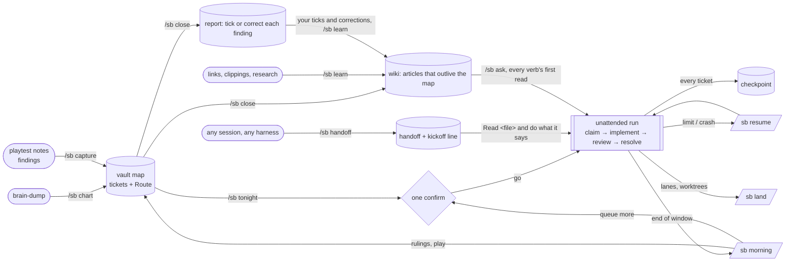

# sb-workflow

`/sb` is one slash command for running coding agents from an Obsidian vault: the vault
(`$SB_VAULT`, else `~/Documents/Second Brain`) is the hub, wayfinder maps and tickets live there as
markdown notes, and every session, model and harness syncs through it. It was built from ~760 past
agent sessions: each verb is a routine that kept being retyped by hand.

## The loop



| verb | ritual it replaces |
|---|---|
| `chart <idea>` | "let's plan it with wayfinder", "grill me", "create a map" |
| `tonight [h] [map]` | "what can I enqueue overnight? I'll be AFK 6 to 8 hours" |
| `morning` | "tl;dr, I just woke up, what was accomplished?" |
| `handoff` | "do you need a fresh context? give me a handoff to paste" |
| `resume` | "another agent ran out of tokens, continue", "reorient me" |
| `capture` | "add these as todos in wayfinder" |
| `land` | "have you merged all the worktrees?" |
| `close <map>` | "write up what this map found so I can review it" |
| `learn [source]` | "save this so future agents know it", "research X and keep the sources" |
| `ask <question>` | "what did we find out about X?" |

## Layout

```
skills/sb/
  SKILL.md            the router: vault, contract, verb table, output contract
  verbs/              one file per verb, loaded only when that verb runs
  reference/          contract (per-repo rules + owner defaults), models (tiers), output (report shape),
                      architecture (mermaid decision tickets, the map's Route), obsidian (the CLI)
  templates/          launch contract, checkpoint, handoff, implementer brief, architecture ticket,
                      map report
  scripts/sbmap.py    full authoring CLI: init, new, show, comment, resolve, frontier, lanes, lint, Route diagram,
                      close; stdlib Python, any harness. Auto-syncs Route diagram on every write.
                      With Obsidian running it also asks the app: broken links, and `verify`
                      (every mermaid block parses in Obsidian's own renderer)
                      `sbmap wiki …` runs the wikibrain skill's tools (below)
mods/obsidian-links/  Claude Code mod: a click on a vault link in chat opens the note in Obsidian
.claude-plugin/       marketplace.json: makes this repo a folder marketplace for the mod
tests/                the CLI run against a throwaway vault: `python3 -m unittest discover tests`
skills-lock.json      skills sb leans on, by GitHub repo: wikibrain (the wiki's format and tools,
                      github.com/DanAmador/wikiBrain, pinned to a commit), karpathy-llm-wiki, design-doc-mermaid,
                      ponytail, i-have-adhd; install.sh fetches them, the repo never vendors them
install.sh            links the skill into ~/.agents/skills and ~/.claude/skills, fetches the locked
                      skills, installs the mod
```

## Requirements

- `python3` and `git`, for `install.sh` and `sbmap`.
- [Obsidian](https://obsidian.md) with the vault open, and its CLI (`obsidian` on the PATH,
  Obsidian ≥ 1.12 with the CLI enabled). sb reads the frontier, backlinks and search through it, and
  `sbmap check` and `sbmap verify` ask it for broken links and mermaid parsing. Without it the
  verbs still work from the files and say what they skipped.
- The Operon plugin in that vault. Ticket and map statuses (`Project.Planned` … `Project.Finished`)
  and `priority` letters are Operon's, and its boards filter on them.
- Claude Code, so `install.sh` can install the `obsidian-links` mod. sb's reports link tickets as
  `obsidian://` links, and without the mod Claude Code Desktop won't open them in Obsidian.
  `install.sh` looks for `claude` on the PATH, then in `~/.local/bin`, and says so when it skips
  the mod.
- The `sb-route-links` CSS snippet, which `install.sh` copies into the vault: a map's Route links
  each ticket node to its note, and the snippet keeps the label in its status colour until hover.
  Enable it once in Settings → Appearance → CSS snippets.
- Optional, work in progress: the Semantra CLI (`semantra search`). Once it lands, `sb find` and
  `sb ask` rank vault notes by meaning through it; until then they fall back to keyword scoring.

## Install

```bash
git clone https://github.com/DanAmador/SB.git sb-workflow
cd sb-workflow
./install.sh
```

`~/.agents/skills` is the shared folder the other harnesses read; `~/.claude/skills/sb` is a
relative link to it, like the other shared skills.

The vault is `$SB_VAULT`, else `~/Documents/Second Brain`; set `SB_VAULT` if yours lives elsewhere.
Repos are looked for under `$SB_CODE`, else `~/Documents/Coding`.

It fetches each skill in `skills-lock.json` from GitHub into `~/.agents/skills/<name>` (one already
there is kept; delete it and rerun to update) and links it into `~/.claude/skills`. To add one,
add its repo and `skillPath` to the lock and rerun.

It also installs the `obsidian-links` mod into each Claude Code config it finds (`~/.claude`, and
any `~/.claude-*` config that has plugins), when `claude` is on the PATH. Reports link tickets as
`obsidian://open?path=…`, which Claude Code Desktop does not open on its own; the mod redraws a
reply holding vault links so a click runs `open obsidian://…`. It is read from `mods/` in place:
edit it, then `/reload-plugins`.

## The tracker is Obsidian-native

Tickets are Obsidian notes: fields in properties, every reference a wikilink, a Bases board per map
(`board.base`, embedded in `map.md`), one per repo (`wayfinder/<repo>/board.base`) plus
`wayfinder/frontier.base` across all maps, and a mermaid
Route. The vault's `wayfinder/README.md` is the format's rulebook; `sbmap migrate` converted the old
header-line tickets on 2026-10-25 (backup under `backups/`, git-ignored).

## sbmap

```bash
# Read (dense, token-efficient digests)
python3 skills/sb/scripts/sbmap.py maps
python3 skills/sb/scripts/sbmap.py status sk4te/one-tether
python3 skills/sb/scripts/sbmap.py show sk4te/one-tether 624

# Write (author 100% through CLI with auto-sync diagram)
python3 skills/sb/scripts/sbmap.py init my-repo/my-effort --title "Title" --destination "Goal" --done-when "Passes"
python3 skills/sb/scripts/sbmap.py new sk4te/one-tether --title "Tether spring" --type task --priority high --question "..." --done-when "..."
python3 skills/sb/scripts/sbmap.py comment sk4te/one-tether 624 --text "R1: ruling"
python3 skills/sb/scripts/sbmap.py resolve sk4te/one-tether 624 --gist "..." --answer "..." --commit "sha"
python3 skills/sb/scripts/sbmap.py close sk4te/one-tether

# The wiki (format and tools: the wikibrain skill, github.com/DanAmador/wikiBrain)
python3 skills/sb/scripts/sbmap.py wiki index --project sk4te
python3 skills/sb/scripts/sbmap.py wiki find tether spring --raw --project sk4te
python3 skills/sb/scripts/sbmap.py wiki new sk4te/physics/tether-spring --title "Tether spring" --type concept --summary "..." --sources sk4te/one-tether#624
python3 skills/sb/scripts/sbmap.py wiki check --fix

# Claims about code: record where a source was read, then check articles against git
python3 skills/sb/scripts/sbmap.py wiki raw my-repo/rendering --title "Render loop" --source "AGENTS.md" --repo-root ~/code/my-repo --rev main --paths src/render --symbols renderQueue --from notes.md
python3 skills/sb/scripts/sbmap.py wiki verify --repo-root ~/code/my-repo

# Share a project with a team's git clone (by pull request, both ways)
python3 skills/sb/scripts/sbmap.py wiki dump ~/code/team-wiki --projects my-repo
python3 skills/sb/scripts/sbmap.py wiki import ~/code/team-wiki
```
