# The night's tokens go to work that lands

## In plain words

> Owner, 2026-11-13: Owner, 2026-11-13: "What's most important is the second tries. Like $57 on second tries? Shit, that's a lot. How exactly would we fix that? ... I don't know, why did they even fail?" Then: "Put it as a discussion and research ticket. We don't want to modify anything until discussed."

Why: the night's spend should go to work that lands, and a ticket should close only when it is really done. Where it stands: the second pass, the one retry, the worker guard, the hub's self-reload and cost per ticket are built (2026-11-14/15). From 2026-11-16 this map holds everything about how a night runs, stops, retries, reviews and spends; page work goes to hub-typed. Open: two talks for you (who may add tickets to a running night, whether hub changes run first) and when a stopped ticket goes to the same model, Opus or you; ten fixes, among them the two moved from night-by-map (requeuing a stopped ticket keeps its work, a recheck waits instead of being skipped). Nothing is queued. You decide next: the two talks.

## Destination

Every retry the hub pays for has a reason to succeed, and every stop that needs the owner reaches the owner instead of a pricier model.

## Route

%% sb:diagram:start %%

```mermaid
%%{init: {"flowchart": {"useMaxWidth": true}}}%%
flowchart TD
    t024[/"024 Why each thrown-away run stopped, and what a second try would have needed"/]
    t025("025 When a ticket stops, who gets it next the same model, Opus, or you")
    t058["058 A ticket closes only when an Opus second pass finds its Done when met"]
    t059["059 A ticket judged Partly or Not met gets one more try with the reviewer's findings, then waits for you"]
    t070["070 A worker cannot close tickets, fake a commit or write outside its own work, because the hook"]
    t080["080 The second pass judges a map's tickets once the map's run has finished, not after each ticket"]
    t086["086 The hub reloads itself after any change to its own code lands, before it runs a review"]
    t087["087 The hub page works again when a worker has refusals, and the guard's tests stop reporting to the"]
    t091["091 A duplicate ticket is merged in one command, and a new ticket that looks like an open one is named"]
    t092["092 A closed ticket says what it cost minutes, tries, model, account and tokens"]
    t093("093 You decide who may add tickets to a night while it runs")
    t094("094 You decide whether hub changes run first in a night")
    t095["095 A task never closes without its second pass"]
    t096["096 Each map's run ends with a review of all its tickets together"]
    t097["097 Only one hub runs, and the morning job says when it cannot reach it"]
    t098["098 Tests and reviews never change files in the main checkout"]
    t099["099 The tests widget stops its test runs and stays quiet during a night"]
    t100["100 A new map knows its repo's folder, and the nine that say only a dot are fixed"]
    t101["101 The worker guard catches the everyday ways around it"]
    t105["105 An error while the hub rebuilds itself no longer blocks its reviews"]
    t102["102 Queueing a stopped ticket again keeps the work Stop saved"]
    t103["103 A ticket waiting on a recheck waits instead of being skipped"]
    t122["122 A ticket whose work cannot land into a checkout with unsaved edits waits for it, instead of failing"]
    t125["125 Finished tickets get their review every 25 minutes, not only when their map ends"]
    t127{{"127 Finished work goes onto one branch, never into stashes or loose folders"}}
    t128["128 A ticket moved to another map keeps its place in the queue, and Land again finds it"]
    t024 --> t025
    t058 --> t059
    t101 --> t105
    t102 --> t103
    classDef done fill:#d3f9d8,stroke:#2b8a3e,color:#2b8a3e
    classDef claimed fill:#fff3bf,stroke:#e67700,color:#7a4100
    classDef frontier fill:#d0ebff,stroke:#1864ab,stroke-width:3px,color:#0b3d6e
    classDef blocked fill:#f1f3f5,stroke:#868e96,color:#495057
    classDef out fill:#f8f9fa,stroke:#adb5bd,stroke-dasharray:4 3,color:#adb5bd
    classDef ext fill:#fff,stroke:#868e96,stroke-dasharray:4 3,color:#495057
    class t024,t058,t059,t070,t080,t086,t087,t092,t128 done
    class t025,t091,t093,t094,t095,t096,t097,t098,t099,t100,t101,t102,t122,t125,t127 frontier
    class t105,t103 blocked
    class t024,t025,t058,t059,t070,t080,t086,t087,t091,t092,t093,t094,t095,t096,t097,t098,t099,t100,t101,t105,t102,t103,t122,t125,t127,t128 internal-link
```

*Blue, thick border: the frontier. Amber: claimed. Green: resolved. Grey: blocked. Dashed: out of scope or another map. Shape is the type: box task, rounded grilling, slanted research, double box prototype, hexagon architecture. Click a ticket to open it. Generated by sbmap; edit the tickets, not this block.*
%% sb:diagram:end %%

## Board

![[wayfinder/sb-workflow/night-spend/board.base#Frontier]]

The live board (Bases): views *Frontier*, *All tickets*, *Board*. This repo's maps: [[wayfinder/sb-workflow/board.base]]. Every map's frontier at once: [[wayfinder/frontier.base]].

## Notes

- Repo: `/Users/danamador/Documents/Coding/sb-workflow`

## Decisions so far
- [Why each thrown-away run stopped, and what a second try would have needed](issues/done/024%20Why%20each%20thrown-away%20run%20stopped,%20and%20what%20a%20second%20try%20would%20have%20needed.md): 39 retried tickets sorted: $20.89 of $56.53 thrown away, none for code difficulty; Opus escalation is the one live cause
- [A ticket closes only when an Opus second pass finds its Done when met](issues/done/058%20A%20ticket%20closes%20only%20when%20an%20Opus%20second%20pass%20finds%20its%20Done%20when%20met.md): A ticket closes only when an Opus second pass finds its Done when met, `e47e6c36907305ca9d583f86bcceb31b4b8231e0`
- [A ticket judged Partly or Not met gets one more try with the reviewer's findings, then waits for you](issues/done/059%20A%20ticket%20judged%20Partly%20or%20Not%20met%20gets%20one%20more%20try%20with%20the%20reviewer's%20findings,%20then%20waits%20for%20you.md): A ticket judged Partly or Not met gets one more try with the reviewer's findings, then waits for you, `356e0d226a0c4db3d7296d268e7cd6907e260394`
- [A worker cannot close tickets, fake a commit or write outside its own work, because the hook refuses it](issues/done/070%20A%20worker%20cannot%20close%20tickets,%20fake%20a%20commit%20or%20write%20outside%20its%20own%20work,%20because%20the%20hook.md): A worker cannot close tickets, fake a commit or write outside its own work, because the hook refuses it, `a22b627ca9ecf029db1559527c590c4faa16c223`
- [The second pass judges a map's tickets once the map's run has finished, not after each ticket](issues/done/080%20The%20second%20pass%20judges%20a%20map's%20tickets%20once%20the%20map's%20run%20has%20finished,%20not%20after%20each%20ticket.md): The second pass judges a map's tickets once the map's run has finished, not after each ticket, `179a41cceef5519c957aeeaa96233bf4ce5685e3`
- [The hub page works again when a worker has refusals, and the guard's tests stop reporting to the live hub](issues/done/087%20The%20hub%20page%20works%20again%20when%20a%20worker%20has%20refusals,%20and%20the%20guard's%20tests%20stop%20reporting%20to%20the.md): The hub page works again when a worker has refusals, and the guard's tests stop reporting to the live hub, `ff6607c3c7420d811135467fdb52ed15ebdb8cdd`
- [The hub reloads itself after any change to its own code lands, before it runs a review](issues/done/086%20The%20hub%20reloads%20itself%20after%20any%20change%20to%20its%20own%20code%20lands,%20before%20it%20runs%20a%20review.md): The hub reloads itself after any change to its own code lands, before it runs a review, `3e2434f5ee3eab808b6784bd71b27fed52c2d266`
- [A closed ticket says what it cost: minutes, tries, model, account and tokens](issues/done/092%20A%20closed%20ticket%20says%20what%20it%20cost%20minutes,%20tries,%20model,%20account%20and%20tokens.md): A closed ticket says what it cost: minutes, tries, model, account and tokens, `af903e958992530b045c8137cb20f0bc922245f4`
- [A ticket moved to another map keeps its place in the queue, and Land again finds it](issues/done/128%20A%20ticket%20moved%20to%20another%20map%20keeps%20its%20place%20in%20the%20queue,%20and%20Land%20again%20finds%20it.md): A ticket moved to another map keeps its place in the queue, and Land again finds it, `990582e057a542d932831f910840d1543c381b67`

## Not yet specified

## Out of scope
